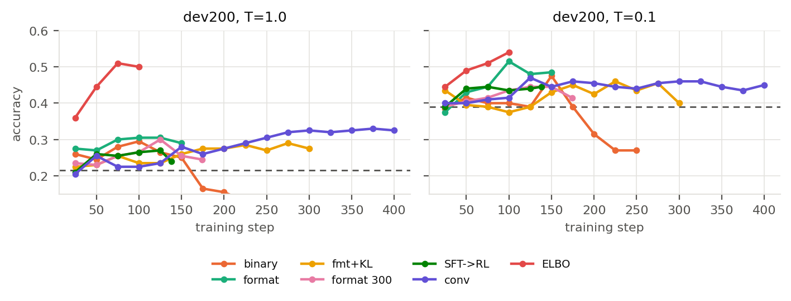
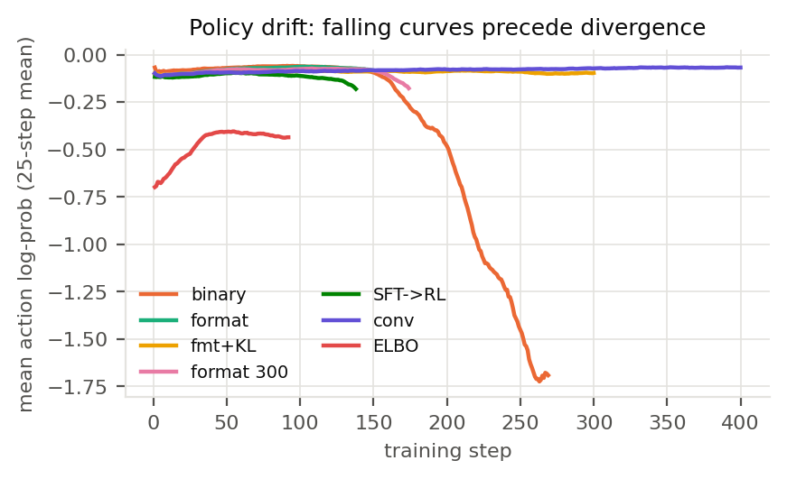
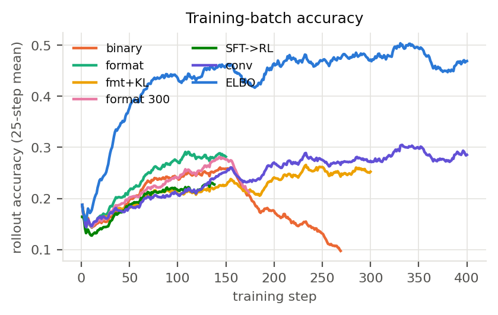
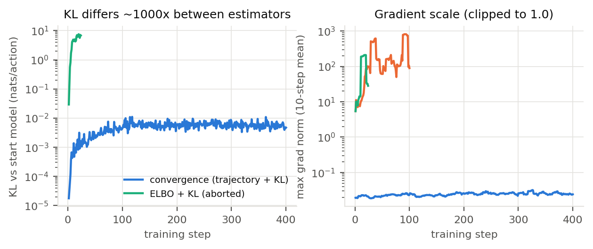
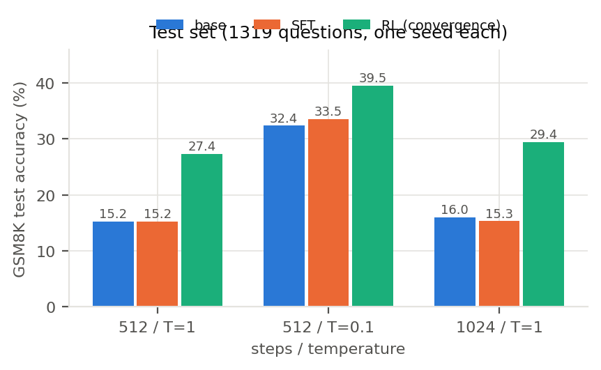
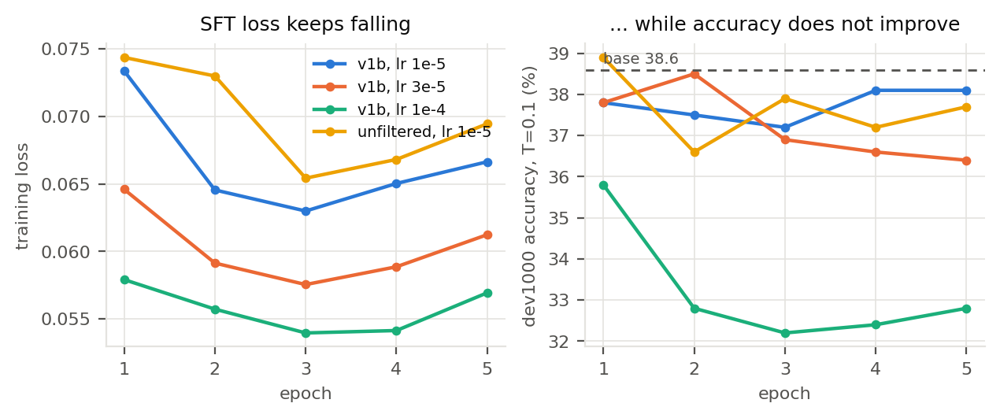
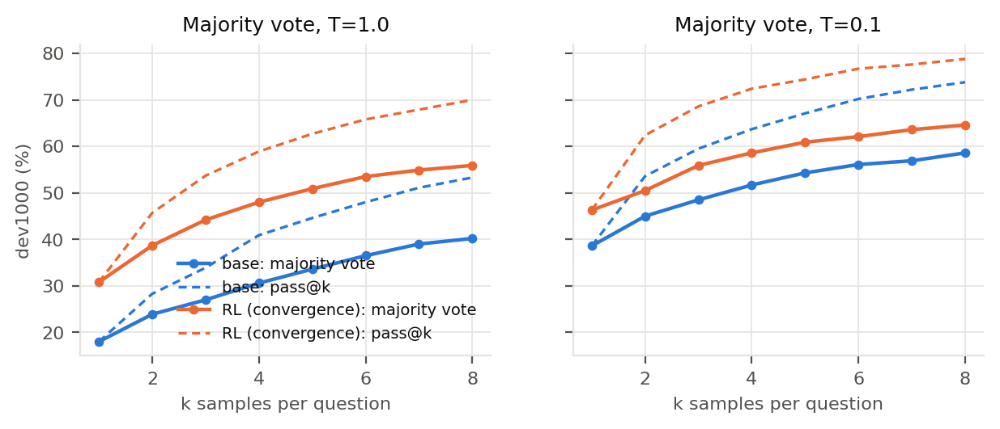
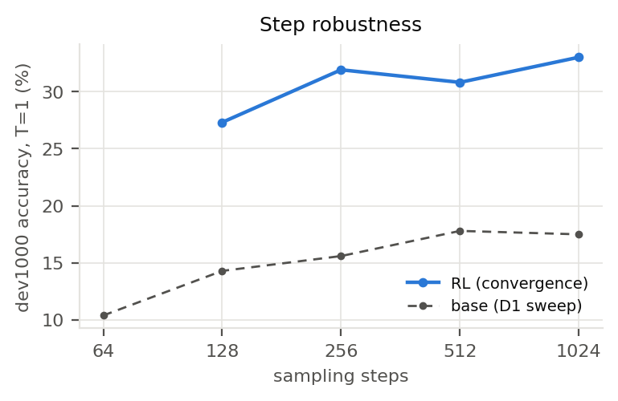

# 报告：TinyGSM 上 MDLM 的 SFT 与 RL（方向一）

> 定稿于 2026-11-04（R49）。所有 GPU 实验已在 11-03 完成，定稿模型 = ELBO 收敛轮第 400 步（D37）。数字出处写在括号里；`runs/` 是仓库内的运行目录。
> 先给结论，再讲原理与设置、结果、过程与反思。本文与题目「预期成果」六项的对应见文末 §9。
> **标注约定**：「已核实」= 有实验或代码依据；「推测，未核实」= 只有间接证据，没有做专门实验。
> 交叉引用：决策依据 [02](02-决策记录.md)、原理 [00](00-任务分析.md) / [03](03-RL算法与模型.md)、全过程复查 [09](09-阶段复查.md)、通俗版 [10](10-通俗讲解.md)、运行说明 [README](../README.md)。

---

## 摘要

在 TinyGSM 上预训练的 170M MDLM 上做了 SFT 与 GRPO RL，在 GSM8K 上用统一协议评测。

| GSM8K test（1319 题） | 512 步 T=1 | 512 步 T=0.1 | 1024 步 T=1（论文设置） |
|---|---|---|---|
| 原始 checkpoint | 15.2 | 32.4 | 16.0（论文 18.0） |
| SFT | 15.2 | 33.5 | 15.3 |
| RL（定稿：GRPO + ELBO log-prob） | **42.8** | **45.4** | **43.1** |

- **SFT 没有提升**：6232 条逐条核验的数据，test 上准确率与原始模型完全相同（201/1319 vs 201/1319）；但对的题并不相同（+47 / −47）。诊断表明它学到的是写法，不是解题。
- **RL 显著提升**：test 上 T=1 +27.6pp、T=0.1 +13.0pp（配对 McNemar p < 1e-19），超过免费的降温技巧（32.4）。
- **反直觉但归因不干净的发现**：RL 梯度里的 log-prob，原本以"精确的轨迹概率"为主线、d1 式 ELBO 近似为对照。实测 **ELBO 臂**在 dev 和 test 上都明显更高（两个收敛轮 test 42.8 vs 27.4，训练部分快约 5 倍），但这个比较同时差着 KL、选点规则，以及交付后审查发现的 **ELBO 臂 loss 归一化实现问题**（§6.3.1）。能说的是"在这套实现和配方下 ELBO 臂更好"，**不能**说"ELBO 估计量本身更优"。最终模型没有重训（无 GPU 预算），详见 §6.3.1。
- **RL 的收益几乎全部来自"代码能跑起来"**：定稿模型在 dev 上运行时错误 383 → 46，而"能跑但算错"的题数基本不变（429 → 448）（§5.5）。
- **RL 会发散**：轨迹法下二值奖励约第 160 步崩，格式奖励只推迟到第 174 步；KL + 学习率衰减可以稳定训练到 400 步。ELBO 不加 KL、只加衰减也能稳定到 400 步。
- **"先 SFT 再 RL"不比"直接 RL"好**：同配置 dev T=1 25.9 vs 31.6，p=0.0005。
- 计算开销：约 55 A800 卡时，总花费约 ¥300（§4.3）。

---

## 1. 结论先行

| 问题 | 回答 | 证据 |
|---|---|---|
| 复现得准不准？ | 16.0%（论文 18.0），偏低但在噪声边缘；原版采样器 15.9%，两者一致 | test 1024 步 T=1 |
| SFT 有用吗？ | **没有**，test 上与原始模型对的题数完全相同（+47 / −47） | 配对 McNemar p=1.00 |
| RL 有用吗？ | **有**，test 512/T=1 15.2 → 42.8 | 配对 +406 / −42，p=7e-76 |
| 提升能归因于解码技巧吗？ | **不能**：降温到 T=0.1 的原始模型 32.4，RL 后 45.4；多数投票在同等采样次数下 RL 仍领先 | §5.4 |
| RL 改进了什么？ | 主要是让代码能跑；推理错误基本没少 | §5.5 |
| 精确轨迹 vs ELBO 近似？ | **ELBO 臂更好**（两个运行一致），但归因不干净（KL、选点、loss 归一化实现问题）；不能断言估计量本身更优 | §5.2、§6.3、§6.3.1 |
| 到 90% 吗？ | **到不了**：同等数据的 AR 也只有 54–63% | §6.6 |

---

## 2. 模型原理与技术路线

### 2.1 MDLM 是什么（已核实：论文与 `code/algo.py`、`code/samplers.py`）

- **前向过程**：每个 token 独立地以概率 1−α_t 被替换成 `[MASK]`；t=1 时整段全遮。
- **训练目标**：连续时间 NELBO，本质是"随机遮盖比例的完形填空"——对被遮位置的交叉熵按 α'_t / (1−α_t) 加权。
- **SUBS 参数化**：已揭开的 token 原样复制，预测分布里 `[MASK]` 的概率置零。所以**一个位置一旦揭开就不再改写**——这是后面轨迹 log-prob 能精确计算的前提。
- **生成（ancestral 采样）**：从全遮盖开始，走 K 步；每步每个仍被遮的位置以 (α_s−α_t)/(1−α_t) 的概率被揭开，揭开时从 p_θ(·|z_t) 采样。同一步揭开的多个 token 在给定 z_t 时**相互独立**，步数越少，这个独立近似误差越大。
- **任务格式**：输入题目，输出一个 `def simple_math_problem() -> int:` 的 Python 函数，执行后与标准答案比对。长度固定 512，答案后面填 PAD。

### 2.2 为什么选 MDLM（170M）

同仓库六个模型里按三个条件筛：① 起点准确率够高（GRPO 每组要"有对有错"）；② 采样策略的 log π 能精确算；③ 有可借鉴的 RL 文献。FLM/CANDI（0.2–0.3%）和 S-FLM（确定性 ODE，没有随机动作）被 ① 和 ② 淘汰；MDLM 与 Duo 打平，MDLM 胜在条件 ②③ 和对采样器优化的适用性（02 D02）。方向二（从头预训练）被否决的理由是预算：一次 170M 预训练按官方训练量需要数百卡时（00 §1.1）。

### 2.3 技术路线

```
原始 checkpoint ──► 评测协议与采样器加速（§2.4）
      │
      ├──► SFT：DeepSeek 改写的 GSM8K train（6232 条，逐条执行核验）
      │
      └──► RL：GRPO（组内相对优势）+ DAPO 技巧，奖励 = 代码执行正确
               log π 两种算法：轨迹法（精确） vs ELBO（近似）
```

所有选择（步数、温度、学习率、checkpoint）都只看 dev；test 只用于复现原始模型和最终评测（§3）。

### 2.4 采样器加速（不是终点，是前提）

原版每步对所有位置做 float64 采样再丢弃，在 80GB 卡上峰值 47GB；dev1000 256 步一次评测 711 s（新版 277 s）。新增 `FastAncestralSampler`（原版保留，用配置切换）：先在 float64 下抽"揭开硬币"，只对选中位置取 logits 并采样；另加 `skip_unchanged` 缓存。

- 等价性三层验证：① 16 组 token 逐位相同；② dev1000 15.0% vs 15.6%（p=0.72）；③ 153s → 76s，显存 47GB → 5GB。
- 副作用如实说明：`skip_unchanged` 与默认路径**同分布但不逐位相同**（TF32 下 cuBLAS 按子 batch 大小换 kernel），逐题对错差 1–4 题，所以所有配对比较都另跑同协议的 base。

### 2.5 RL 的核心技术点：log π 怎么算

GRPO 需要 log π，而 π(y|x) 要对所有揭开顺序求和，算不出。两条路线：

- **轨迹法（原主线，`rl/logprob.py` 的 `logp_at_rounds`）**：策略梯度只需要 π(τ)——**这一条轨迹**的概率。在 MDLM 上它可以精确分解为"每轮新揭开位置的 log p"之和（哪些位置被揭开与 θ 无关）。实现：由（最终 token，揭开轮次）还原每一轮的画布（依赖"揭开后不再改写"）；每条轨迹分层抽 8 轮、按层大小加权，无偏。精度：训练用 fp32 log-softmax，采样器在 bf16 下；更新前比率严格为 1（实测误差 0），训练-推理差最大 0.061（一个 bf16 ulp）。
- **ELBO（对照臂 → 定稿，`logp_elbo`）**：d1 式近似。每条轨迹只做**一次**前向：答案全部遮住、题目可见，把各位置的 log p 加起来当作 log π。它不对应实际采样用的逐步策略，所以原本只作对照。与 d1 的差别：我们不随机遮题目。
- **一个容易忽略的口径差**：训练 rollout 用 128 步，评测用 512 步 + skip。轨迹法精确的是 **128 步采样过程**的 π(τ)，"与评测策略一致"只在步数相同时成立；ELBO 的全遮一次前向不绑定步数。这可能是 ELBO 臂优势的一部分来源（未验证）。

---

## 3. 实验设置

| 项 | 设置 |
|---|---|
| 数据划分 | GSM8K train 去掉 dev 后 6473 / dev 1000 / test 1319；dev 前 200 题（dev200）用于 RL 中途选 checkpoint，后 800 题无偏报告 |
| 污染检查 | TinyGSM 全量 13-gram：test 2.2% 含任一 13-gram、近重复 1 题；dev 近重复 13%；base 在近重复题上高 3.5pp，不显著（`runs/1030-contamination-13gram/report.md`） |
| 评测协议 | 新采样器 512 步 + `skip_unchanged`，T ∈ {1, 0.1}，seed 1，batch 200；定稿另跑 1024 步对齐论文 |
| 统计 | 逐题配对 McNemar 精确双侧检验；bootstrap 95% CI。单次 dev1000 的标准误约 1.5pp，dev200 约 3pp |
| SFT 数据 | DeepSeek 把 GSM8K train 题改写成 TinyGSM 风格 Python；执行结果必须等于标准答案，另做语义检查与人工复核；v1b 6232 条，估计残余错误约 0.3%（`data/sft/README.md`） |
| SFT 训练 | 自写循环、复用上游 NELBO loss、从 EMA 权重出发；lr ∈ {1e-5, 3e-5, 1e-4} × 5 epoch，batch 64，cosine |
| RL 题库 | 6473 题去掉标准答案错 / 有歧义的，剩 6312 题；与 dev、test 不重叠（代码断言） |
| RL 配置 | GRPO + DAPO 技巧（clip-higher 0.2/0.28；动态采样只丢弃全对 / 全错的组、不补采；token 级归一化——PAD 计入动作后每条轨迹动作数几乎相同，这一项基本退化，02 D20）；每步 32 题 × G=8；rollout 128 步、T=1；lr 3e-5，每批 4 次更新；去掉组内 std（Dr. GRPO）；梯度裁剪 1.0 |
| 奖励 | 代码执行结果等于标准答案得 1；格式分臂另给"能跑但算错" 0.1 |
| 定稿配方 | 上述 + 格式分 0.1 + ELBO log-prob + cosine 衰减到 10% + 梯度尖峰跳过（超过近 50 次中位数 10 倍）+ log-prob 刹车；400 步；无 KL |
| 选点规则 | 每个配方事先写定（单点最高 → 三点平滑 → 收敛轮取最后一步，02 D32–D35）；跨配方定稿 = dev1000 两温度平均最高（D37） |

---

## 4. 实验记录

### 4.1 运行了什么

| 阶段 | 运行 | 结果目录 |
|---|---|---|
| D1 | 采样器三层验证；论文设置复现；dev 步数 × 温度扫描 | `runs/1030-D1-summary.md` |
| D2 | SFT 3 lr × 5 epoch + 数据过滤消融，共 42 次 dev1000 评测 | `runs/1030-D2-sft-summary.md` |
| D4 | RL 调试 5 组 × 50 步（学习率、std、格式分） | `runs/1030-D4-grpo-summary.md` |
| D5 | 二值 / 格式分 / 格式分 + KL / SFT → RL / 格式分 300 步 / 收敛轮 400 步 | `runs/1030-D5-grpo-summary.md` 及各运行目录 |
| D6 | test 主表、步数鲁棒性、多数投票 | `runs/1103-D6-test-summary.md` |
| D7–D8 | ELBO 对照臂 150 步、ELBO 收敛轮 400 步、base 投票、定稿 test | `runs/1103-grpo-elbo-*`、`runs/1103-test-elboconv-*` |

每次运行都记了配置、git commit、指标和日志；完整列表与卡时在 [06「运行记录」](06-进度.md)。

### 4.2 训练曲线



> **图 1**：各 RL 配置在**留出的 dev200** 上的准确率，每 25 步一个点；虚线是 base 的同协议参照（左 T=1、右 T=0.1）。两条读法：
> ① 轨迹法各臂：第 150 步之后，二值奖励（橙）一路跌到 base 以下，格式奖励（青）与 KL 轮（黄）持平或略跌，收敛轮（紫）持续缓慢上升；
> ② ELBO（蓝，无 KL，定稿）前 75 步就超过所有轨迹法配置，之后在两温度平均 49–52 的平台上；T=0.1 在第 125 步后从 54.5 缓降到 47–50。
> 单点噪声约 ±3pp，横轴上的折返不要逐点解读。



> **图 2**：被揭开 token 的平均 log-prob（25 步滑动平均），用来判断训练是否在崩。二值奖励（橙）从 −0.06 一路掉到 −1.7，是熵爆炸式的发散；SFT → RL（深绿）与格式奖励 300 步（粉）在 −0.08 → −0.18 一带掉下去，随后被刹车停住；收敛轮（紫）和 KL 轮（黄）稳定在 −0.08 附近。
> **ELBO（蓝）的绝对值不能与轨迹法比较**——它是在全遮盖画布上算的概率，本身就低（−0.4 ~ −0.7），只应看它的形状是否平稳。



> **图 3**：训练 rollout 正确率（25 步滑动平均），每点来自 32 道题。它受"每批题难不难"影响很大，只用来和别的运行做同题比较（所有运行同 seed、同题序）。



> **图 4**：左：与起点模型的 KL（纳特 / 动作，对数轴）。轨迹法收敛轮稳定在 10⁻³ 量级；ELBO 带 KL 的那次日志值第 20 步就到 6–7，但其中约 120 倍来自 §6.3.1 的权重广播，真实每动作约 0.05；同一次运行里 policy loss 和 KL 被同一因子放大，β·KL 仍约为策略梯度的 8–10 倍，所以那次尝试被停掉（02「已更正的判断」）。右：每步最大梯度范数（10 步均值，对数轴）：日志里 ELBO 比轨迹法大 2–3 个数量级，其中约 120 倍来自 §6.3.1，扣掉后约 10–20 倍；只有 ELBO 被裁剪到 1.0，轨迹法常态约 0.02、没有被裁剪；ELBO 收敛轮 1600 次更新里有 140 次（8.8%）因超过最近 50 次中位数的 10 倍被跳过。

### 4.3 计算开销

| 项 | 数值 | 来源 |
|---|---|---|
| GPU | 单张 A800 80GB（AutoDL） | — |
| GPU 计算合计 | 约 55 卡时：RL 训练（含调试与中途 dev200 评测）约 43，SFT 扫描（含 42 次评测）约 4，其余评测与分析约 8；部分条目是估计 | 06「运行记录」逐行相加（SFT 扫描在 06 里记了两行，只算一次） |
| 实际花费 | 约 ¥300（含开机未跑任务的时间）；另有 DeepSeek API 约 ¥20–40（估计） | 用户账单（11-03） |
| 题目预算 | ¥100；超出部分经用户决定不设上限（02 D24） | — |
| 一次 dev1000 评测 | 约 5.5 分钟（512 步 + skip，batch 200） | 06 D2 §2 |
| SFT 一个 epoch | 约 40 秒（6232 条） | `runs/1030-sft-v1b-lr1e-5/metrics.json` |
| RL 一步 | 轨迹法：rollout 34 s + 训练 40 s ≈ 75 s；ELBO：34 s + 8 s ≈ 42 s | 两个收敛轮的 `train_log.jsonl` |
| 定稿运行（400 步） | 训练 5.3 小时（含每 25 步的 dev200 评测）；轨迹法收敛轮 9.0 小时 | 同上 |

"ELBO 快约 5 倍"只指**训练部分**：400 步收敛轮 8.3 s vs 40 s（约 4.8 倍）；150 步对照是 8.9 s vs 32 s（约 3.6 倍）。rollout 两者相同，整步约快 1.8 倍。

---

## 5. 结果

### 5.1 主表（dev1000，512 步 + skip）

| 模型 | T=1 | 后 800 | T=0.1 | 后 800 |
|---|---|---|---|---|
| 原始 base | 18.0 | 17.1 | 38.6 | 38.5 |
| SFT（lr 1e-5，epoch 1） | 16.2 | 15.8 | 37.8 | 37.8 |
| RL 轨迹法（收敛轮第 400 步，原定稿 D36） | 30.8 | 30.4 | 46.3 | 46.6 |
| **RL ELBO（收敛轮第 400 步，定稿 D37）** | **50.0** | **49.4** | **50.5** | **50.6** |

### 5.2 RL 配方对比（dev1000，各自按事先定的规则选点）

| 配方 | log-prob | 选中步 | T=1 | T=0.1 | 平均 | 是否经过挑选 |
|---|---|---|---|---|---|---|
| **ELBO 收敛轮（无 KL，cosine）——定稿** | ELBO | 400 | **50.0** | **50.5** | **50.25** | 否（最后一步） |
| ELBO 对照臂（格式分，150 步） | ELBO | 150 | 48.1 | 51.3 | 49.70 | 否（smooth3 选中最后一步） |
| 格式分 100 步 | 轨迹 | 100 | 31.6 | 46.4 | 39.00 | 是（单点最高） |
| 收敛轮 400 步（KL + cosine，原定稿） | 轨迹 | 400 | 30.8 | 46.3 | 38.55 | 否 |
| 格式分（300 步跑满） | 轨迹 | 125 | 30.6 | 46.4 | 38.50 | 是 |
| 格式分 + KL | 轨迹 | 225 | 29.7 | 46.8 | 38.25 | 是 |
| 二值奖励 | 轨迹 | 150 | 28.5 | 46.2 | 37.35 | 是 |
| SFT → RL | 轨迹 | 125 | 25.9 | 46.8 | 36.35 | 是 |

两点结论（已核实）：
1. **轨迹法内部**，除 SFT → RL 外的各配方两两配对都不显著（p = 0.054–1.00）：奖励怎么设计、加不加 KL，影响远小于"做不做 RL"。（0.054 是格式分 100 步 vs 二值 150 步；SFT → RL 与多个配方显著更差，p = 0.0005–0.015。）
2. **"ELBO 臂更好"是一个实现+配方的整体结果，不是单变量结论。** 两个 150 步运行的训练配置表面上都无 KL、都是格式奖励，但 ELBO 臂的 loss/KL 存在权重广播放大（§6.3.1），所以不是"只差 log-prob 算法"；两者选中的 checkpoint 也不同（轨迹法单点最高第 100 步，ELBO 三点平滑第 150 步）。两个收敛轮（400 步）之间还差 KL（轨迹法 β=0.04，ELBO 无 KL）。两个 ELBO 运行之间差 0.55pp（不显著），但这只是同一实现内的一致性。ELBO 的优势主要在高温。

### 5.3 test 主表



> **图 5**：GSM8K test（1319 题，每题一个 seed）。三组柱子依次是 512 步 / T=1、512 步 / T=0.1、1024 步 / T=1（论文设置）。两个 RL 模型都明显高于 base 与 SFT；ELBO 定稿在三个设置下都最高；SFT 与 base 几乎重合。

| 模型 | 512/T=1 | 512/T=0.1 | 1024/T=1（对齐论文） |
|---|---|---|---|
| base | 15.2 | 32.4 | 16.0（论文 18.0；D1 原版采样器 15.9） |
| SFT | 15.2 | 33.5 | 15.3 |
| RL 轨迹法（收敛轮第 400 步，原定稿 D36） | 27.4 | 39.5 | 29.4 |
| **RL ELBO（收敛轮第 400 步，定稿 D37）** | **42.8** | **45.4** | **43.1** |

配对检验（512 步）：
- 定稿 vs base：T=1 +406 / −42（p = 7e-76），T=0.1 +267 / −95（p = 5e-20）；
- 定稿 vs 原定稿：T=1 +295 / −91（p = 3e-26），T=0.1 +190 / −112（p = 8e-6）；
- 原定稿 vs base（T=1）+219 / −59（p = 8e-23）；SFT vs base +47 / −47（p = 1.00，对的题数完全相同，只是换了一批）。

test 比 dev 难：base 与各 RL 模型都低约 3–7pp，dev 上的相对比较仍然成立。

**如实说明 test 的使用**：定稿先定为轨迹法收敛轮（D36）并跑了 test；之后 ELBO 对照臂在 dev 上明显更好，按事先写好的规则（D37：候选中 dev1000 两温度平均最高）改为 ELBO，再跑一次 test。两次选择都只看 dev，test 没有参与选择；但 test 一共被两个 RL 模型用过，两行都保留。

### 5.4 消融与对照



> **图 6**：SFT 的四组配置（左：训练 loss；右：T=0.1 的 dev 准确率）。loss 在每个学习率下都单调下降，准确率没有跟着上来；lr=1e-4（绿）loss 降得最多、准确率掉得最狠（第 2 个 epoch 起显著差于 base）。这是"SFT 学的是写法，不是做题"最直接的一张图。



> **图 7**：同题采 k 次、取多数答案（实线）与 pass@k（虚线），base 与**轨迹法**收敛轮 RL 并排（ELBO 定稿的投票没有做，成本原因）。左 T=1、右 T=0.1。
> ① 同样采样预算下 RL 始终领先（k=8：T=1 55.9 vs 40.2，T=0.1 64.6 vs 58.6），"涨分只是投票"的说法不成立；
> ② RL 单次（30.8）≈ base 投票 4 次（30.6）；
> ③ 虚线（pass@k）明显高于实线（投票），说明能力在、但多数题只能靠"多试几次"取出来。



> **图 8**：轨迹法 RL（原定稿）在 dev 上随采样步数的准确率（T=1；ELBO 定稿未重做，成本原因），与 base 的 D1 扫描并列。RL 后 128 步就有 27.3%，256 步 31.9% 已接近 1024 步的 33.0%；base 从 64 步的 10.4% 到 1024 步的 17.5%。

| 消融 | 结果 |
|---|---|
| SFT 数据过滤 vs 不过滤（D10） | 10 组配对全不显著（≤1.1pp），能检出 2–3pp 以上 |
| SFT 学习率 1e-5 / 3e-5 / 1e-4 | loss 越低准确率越差；1e-4 从第 2 个 epoch 起显著更差 |
| 格式奖励（能跑但错给 0.1） | 有信号样本 47% → 93%，运行时错误显著下降；但**在 dev 上与二值不可分辨**，且只推迟发散 14 步 |
| KL β=0.04（轨迹法） | 让训练跑到 300/400 步不崩；代价是学习略慢（与跑间随机性同量级） |
| 每批 4 次更新 | 同一批 rollout 上用 PPO clip，clip 比例 0.5–1.5%，始终未饱和 |
| PAD 是否计入动作（D20） | PAD 占动作 68%、只占梯度范数 11%（梯度诊断）；没有做两臂训练对比（成本原因） |
| 步数鲁棒性（轨迹法 RL，dev，T=1） | 128 / 256 / 512 / 1024 步 = 27.3 / 31.9 / 30.8 / 33.0；base（D1）64 步起 10.4 / 14.3 / 15.6 / 17.8 / 17.5。RL 后 256 步已接近平台 |
| 多数投票 / pass@k（dev，8 个不同 seed；RL 指轨迹法原定稿） | k=8 时 T=1 base 40.2 vs RL 55.9，pass@8 53.3 vs 70.0；T=0.1 58.6 vs 64.6，pass@8 73.8 vs 78.8。ELBO 定稿单次 T=1 就有 50.0，已高于 base 投 8 次（40.2）；它自己的投票没有做 |
| 精确轨迹 vs ELBO 近似（D12） | **ELBO 臂更好，但归因不干净**：150 步 dev1000 48.1 / 51.3 vs 31.6 / 46.4（选点规则不同）；收敛轮 400 步（轨迹法带 KL、ELBO 不带）50.0 / 50.5 vs 30.8 / 46.3；test 42.8 / 45.4 vs 27.4 / 39.5。**交付后审查发现 ELBO 臂的 loss/KL 被权重广播放大 ~120 倍（§6.3.1），所以这不是单变量对照。** |

### 5.5 错误分析：RL 改进了什么（dev1000，`runs/1104-error-breakdown-final.txt`）

用评测同款的抽取和执行，把每个答案分成：对 / 能跑但算错 / 运行时错误（异常或超时）/ 语法错误 / 没有函数。

| 模型 | T | 对 | 能跑但错 | 运行时错 | 语法错 | 平均长度（字符） |
|---|---|---|---|---|---|---|
| base | 1 | 180 | 429 | 383 | 7 | 545 |
| RL 轨迹法（原定稿） | 1 | 308 | 475 | 207 | 9 | 502 |
| **RL ELBO（定稿）** | 1 | **500** | 448 | **46** | 6 | 450 |
| base | 0.1 | 386 | 474 | 138 | 2 | 485 |
| RL 轨迹法（原定稿） | 0.1 | 463 | 463 | 74 | 0 | 470 |
| **RL ELBO（定稿）** | 0.1 | **505** | 452 | **38** | 5 | 448 |

读法（已核实，计数直接来自上表）：
1. **收益几乎全部来自"代码能跑起来"**。T=1 下定稿比 base 多对 320 题，运行时错误少了 337 题，"能跑但算错"反而多了 19 题。T=0.1 下多对 119 题，其中运行时错误少 100、算错少 22。
2. **"能跑但算错"在所有模型上都停在约 430–475 题**，也就是近一半的题模型写出了能跑、但逻辑不对的程序，RL 没有改变这一块。这一块对应推理错误，是到不了 90% 的主要原因之一（§6.6）。
3. **定稿模型对温度几乎不敏感**（T=1 50.0 vs T=0.1 50.5；长度 450 vs 448；docstring 写法 1000 题里 998 题用同一种引号）。一种解释是它把"降温"学进了权重、输出分布变尖了（推测，未核实）。代价是多样性可能下降——pass@k 没有在定稿上测，所以这一点**未核实**。

### 5.6 效果展示（demo，`runs/1103-demo-final.txt`）

同一道题，base 与定稿模型各生成一次（同一 seed，T=0.1，512 步），执行并判定。题目按固定编号选取（dev 第 3、17、42、88、137 题），不是按结果挑的；5 题只作样例，不代表准确率。

| dev 题号 | 题目（缩写） | base | 定稿 | 看点 |
|---|---|---|---|---|
| 42 | 集邮册：前 10 页每页 5 行 × 30 张，其余 40 页每页 50 张 | 运行时错误（`stamps_total` 未定义，前面定义的是 `total_stamps`） | **对**（`10*5*30 + 40*50`） | 正是 §5.5 的主要收益类型：base 思路接近但写错变量名；定稿写得更短、变量自洽 |
| 3 | 存款 $100，每天花 $8，一周后取尽可能多的 $5 钞票，余额多少 | 算错（返回取钞前余额） | 算错（返回钞票张数） | 两者都没读懂"剩下多少"，推理错误 RL 没修好 |
| 17 | 20 枚币每枚 $15，涨 2/3 后卖多少枚能回本 | 算错 | 算错 | 多步比例题，两者都错 |
| 88 | 菜园剩余空位 | 对 | 对 | 简单题两者都对 |
| 137 | 4 倍加 6 | 对 | 对 | 同上 |

base 2/5，定稿 3/5。轨迹法原定稿在同一组题上是 1/5（`runs/1103-demo.txt`）。

---

## 6. 过程分析与反思（这一节是重点）

### 6.1 无效的尝试

| 尝试 | 结果 | 原因 |
|---|---|---|
| SFT（6232 条高质量数据，3 个 lr × 5 epoch） | 不涨分，高温更差 | 模仿学的是写法（lr 3e-5 epoch 2 的诊断，08 Q21）：docstring 引号风格从 `'''` 整片换成 `"""`（T=0.1 下 105 → 977 题），T=0.1 语法错归零，但 T=1 下 NameError 343 → 393；分布压窄后高温更容易偏 |
| 数据过滤消融 | 无差别 | SFT 本来就没学到推理，3.6% 的错误样本无从体现 |
| 格式奖励 | dev 上无差别，只推迟发散 | 信号变密了，但方向不变 |
| 前两轮 RL 超参（lr 1e-6–1e-5，单次更新） | 约 4 卡时白跑 | 权重只动 0.045%，"学习率太小" |
| 第一次 KL 轮（不截断 k3） | 第 14 步梯度范数约 2500 | exp(d) 无界，等于一次异常更新 |
| ELBO 收敛轮第一次尝试（照搬 β=0.04） | 第 24 步停掉 | ELBO 下 KL 6–7 nats/动作（轨迹法约 0.006），β·KL 约为策略梯度的 10 倍 |
| 先 SFT 再 RL | T=1 显著差于直接 RL（p=0.0005） | 推测：SFT 把高温分布压窄、出错更多，起点 log-prob 也更低，更早进入不稳定区（未核实） |

### 6.2 踩过的坑（工程）

| 坑 | 症状 | 定位方式 | 修复 |
|---|---|---|---|
| SFT 分隔符 | val loss 20 步降 3 倍 | 拆 loss + 单 token 遮盖测试：base 在答案第一个位置 64 题全错 | 用字面量 `\n`（反斜杠 + n，与 checkpoint 保存的配置一致），加断言 |
| `skip_unchanged` 不逐位相同 | 逐字测试"失败" | 扫子 batch 大小发现 kernel 切换 | 同分布即可，配对比较用同协议 base |
| 逐字测试受 `torch.compile` 影响 | 16 组全"失败" | 编译后随机数生成方式与 eager 不同 | 逐字测试关闭编译；编译路径由统计检验覆盖 |
| 上游数据缓存目录只跟 tokenizer 有关 | 换 split 会悄悄复用旧缓存 | 读代码 | 每个 split 单独一个缓存目录 |
| KL 日志 | 值小约 30 倍 | 代码审查 + 冒烟对比 | 每个 chunk 已全局归一化，不再加权平均 |
| 刹车变量名冲突 | 首次启动第 1 步崩 | 日志回溯 | 改名；**改训练循环必须用正式参数冒烟** |
| 选点规则挑到噪声尖峰 | dev200 单点最高 ≠ 最好 | 看两侧邻点 + 训练正确率 | 三点平滑 / 收敛轮取最后一步 |
| 换 log-prob 时照搬 KL 系数 | ELBO 收敛轮训练正确率逐步落后（−6pp） | 算 β·KL 与策略梯度 loss 的比例 | 去掉 KL；换估计量前先估 KL 量级 |

### 6.3 被实验推翻的预期：精确轨迹 vs ELBO

我们原本的判断（D12）：轨迹法是"精确且与采样策略一致"的 log π，ELBO 是"有偏、和逐步采样不一致"的近似，所以轨迹法做主线、ELBO 只作对照，并预测 ELBO"更便宜但更差"。实验结果相反：**ELBO 臂**在 dev 和 test 上都明显更好，训练部分也快约 5 倍。但下面的"已核实事实"要连同 §6.3.1 的实现问题一起读：这些数字里有一部分不是 log-prob 估计量本身的差异。另外，轨迹法的"与采样策略一致"只对训练用的 128 步采样成立，评测是 512 步。

**已核实的事实**：
- 差距方向稳定：两次不同长度、同 seed 的 ELBO 运行（150 步、400 步）dev1000 差 0.55pp；相对轨迹法的差距在 dev 和 test、两种温度上方向一致。两次运行共享同一实现，所以这是实现内一致性，不是独立验证。
- 差距集中在高温和运行时错误上（§5.5）：T=1 下轨迹法定稿仍有 207 题运行时错误，ELBO 只有 46。
- 日志里的梯度量级差约 3 个数量级（ELBO 中位 32、最大 1.5e8；轨迹法中位 0.019）。其中约 120 倍来自 §6.3.1 的权重广播，扣掉后约 10–20 倍。只有 ELBO 被裁剪到 1.0；轨迹法没有。
- 轨迹法里 PAD 占动作的 68%，平均 log p ≈ −0.002（`runs/1031-diag-kl-grad/`）。

**可能的原因（推测，都没有做专门实验核实）**：
1. **信号强度**：轨迹法里大多数动作是在画布几乎写满时揭开的，模型此时几乎确定，这些动作的梯度接近 0；有效信号只来自少数早期、不确定的位置。ELBO 在全遮盖画布上算每个位置的概率，所有位置都处在"最不确定"的状态，每个 token 都贡献梯度。
2. **训练的正好是第一步的决策**：生成从全遮盖画布开始，ELBO 优化的就是这一步的预测；而早期写下的 token 决定了后面整条轨迹的走向。
3. **ELBO-GRPO 近似于"用自己的样本做加权的预训练"**：ELBO 的 loss 是全遮盖噪声水平下的去噪交叉熵，与预训练目标同一形式；乘上优势后，相当于提高自己做对的程序、压低做错的程序在这个目标下的似然。和 SFT 的区别是数据来自模型自己的分布，而不是外部写法。这可以解释为什么它有效、为什么输出变尖（§5.5 第 3 点），但这是解释，不是验证。
4. **"无偏"不等于"好用"**：轨迹法的梯度估计无偏，但每条轨迹只抽 8 轮，方差 / 信噪比可能更差。

**要核实需要的实验**（没做）：按揭开轮次统计轨迹法的梯度贡献；轨迹法只保留早期轮次；混合两种估计量；多 seed 复现。

**代价也要说清楚**：ELBO 梯度波动极大（全靠裁剪），8.8% 的更新被尖峰规则跳过；日志里的 KL 比轨迹法大约 100 倍，扣掉权重广播后真实每动作约 10 倍；第 125 步之后低温表现缓慢退化（dev200 T=0.1 从 54.5 降到 47–50），高温稳定；只有一个题序 seed。

### 6.3.1 交付后审查发现的实现问题：ELBO 臂的 loss/KL 被放大 ~120 倍（R50，11-09）

这部分是 11-09 对定稿做代码审查时发现的，**在最终实验之后**，没有重训（面试前不打算再用 GPU），如实记录。

- **位置**：`code/rl/grpo.py` 的 `grpo_loss` 里 `w = weights[:, :, None] * act`。
- **机制**：轨迹法的 `act` 是 `(N, m, L)`，与 `weights (N, m)` 对齐；ELBO 的 `act` 是 `(N, 1, L)`（一条轨迹一个槽），与 `weights (N, m=8)` 广播后变成 `(N, 8, L)`。`select_rounds` 的权重之和等于该轨迹的非空揭开轮次数 R_n（`code/tests/test_rl_logprob.py` 自己断言了这一点）。128 步、约 450 个生成位置时 R_n 约 120（模拟范围 117–128）。因此 ELBO 的 loss 和 KL 被乘了 R_n，而分母仍按真实动作数计算。
- **影响**：
  - 日志里的 ELBO 梯度范数、KL 被放大约 120 倍。"比轨迹法大 3–4 个数量级""KL 大约 1000 倍"都不成立；扣掉后分别是约 10–20 倍和约 10 倍。
  - R_n 随轨迹略有变化（约 ±5%），所以 ELBO 臂实际优化的是"按非空轮次数轻微加权"的目标，不再是严格的 token 级 GRPO。Adam 能抵消近常数因子，因此最终模型**可能**接近原意，但这是推断，没有验证。
  - "两个 150 步运行只差 log-prob"不成立：还差这个归一化。
- **保住的部分**：停掉 KL 的决定仍成立——policy loss 和 KL 被同一个因子放大，β·KL / policy loss 的比例不变（约 8–10 倍）。所有准确率数字（test 42.8 / 45.4 / 43.1 等）都是在这个实现下实测的，仍然有效；失效的是"ELBO 估计量本身更优"的因果解释。
- **修复与验证（没做）**：ELBO 分支传 `weights = ones(N,1)`，`grpo_loss` 加形状断言；补 ELBO loss 归一化和 backward 测试；用修复代码重跑前 100 步与旧 run 对比，必要时重跑 400 步收敛轮。

### 6.4 方法论上的判断（如实记录）

1. **"只有一个 seed"的影响被实测了**：两次同配置、同 seed 的运行，dev200 每点差 1–5pp，但选中 checkpoint 的 dev1000 差别 p = 0.56 / 1.00。跑间差异主要影响"选哪一步"，不影响"最终水平"。
2. **dev 后 800 题的"无偏"只在单个配方内成立**：跨配方挑定稿时用到了 dev1000 全部，这时只有 test 是干净的。
3. **test 被两个 RL 模型用过**（§5.3）。两次都按事先写好的规则、只看 dev 选择。
4. **被更正的判断**一共记了 32 条（02「已更正的判断」，R50 前）；R50 又补了 ELBO 臂归一化这一条，现为 33 条。包括：提速倍数、SFT 预期、RL 学习率、KL 归因、pass@8 计算、ELBO 预期、ELBO 归一化。

### 6.5 止损点（D17）的执行情况

| 检查点 | 条件 | 实际 | 结果 |
|---|---|---|---|
| D1 | 复现不在 18±3% → 停下修评测 | 15.9%（原版）/ 16.0%（新版） | 在范围内，继续；偏低的原因未核实（seed 方差、论文统计方式、环境差异） |
| D1–D2 | 采样器验证半天内不通过 → 回退原版 | 三层验证当天通过 | 采用新采样器 |
| D3 | rollout 准确率与评测脚本不一致 → 先查原因 | 128 步 dev1000：T=1 13.8 vs 14.3（p=0.75），T=0.1 33.6 vs 36.2（p=0.22） | 一致 |
| D5 晚 | GRPO 在 dev 上无提升 → 改用多轮 RFT | 二值臂第 150 步 dev1000 T=1 18.0 → 28.5（p < 0.001） | 未触发；RFT 没做 |

### 6.6 能力上限：为什么到不了 90%

- **模型与数据**：同一份 TinyGSM、同规模的 AR 模型也只到 54–63%（论文 Table 2）；MDLM 同一步揭开的 token 相互独立，更难。
- **一次生成，没有草稿和检查**：512 token 内一次写完，没有思维链、自我验算。
- **我们的数据**：§5.5 里"能跑但算错"始终约 45%，RL 只修好了"跑不起来"。base 的 pass@8 在 T=0.1 是 73.8%，是"多试几次能取出来"的程度，不是单次准确率能到的。

### 6.7 没做的部分与原因

| 没做 | 原因 |
|---|---|
| ELBO 定稿的多数投票、pass@k、步数鲁棒性 | 结果在最后一天出来，用户决定不再开 GPU（成本已约 ¥300）；对应的图都用轨迹法原定稿，已在图注里说明 |
| 多 seed 复现 | 每个 400 步运行 5–9 卡时 |
| 修复 §6.3.1 的归一化后重跑 ELBO 收敛轮 | 11-09 审查时才发现；面试前不再用 GPU（用户决定），只修口径与代码 |
| ELBO 机制的专门实验（§6.3） | 同上；只能标为推测 |
| 多轮 RFT | 止损点没有触发，GRPO 已有效 |
| Duo 对照、半自回归 / 置信度解码 | 时间优先给 RL 调参；置信度解码会破坏轨迹法的精确性前提（02 D16） |
| PAD 是否计入的两臂训练对比 | 只做了梯度诊断（PAD 占梯度范数 11%） |

### 6.8 下一步

- **先修 §6.3.1 的归一化再谈机制**：ELBO 分支用 ones 权重、加形状断言，重跑 100 步对照，再按揭开轮次拆分梯度贡献、轨迹法只保留早期轮次、多 seed 复现。修复前，"ELBO 更好"只能作为实现+配方的经验结果。
- **"能跑但算错"这一块**：RL 没有动它。可以试过程奖励（中间值与标准解对上给分，SFT 数据里已有中间值标注）、或更长 / 带草稿的输出格式。
- **多样性**：测定稿的 pass@k，确认输出变尖有没有损失可探索性；必要时加熵正则或用更合适量级的 KL。
- **数据与规模**：RFT 多轮迭代、混入 TinyGSM 原数据防遗忘；换更强的预训练模型，或用 Duo 验证"可改写 token"是否让 RL 更有效。

---

## 7. 代码与运行说明

运行说明见仓库根目录 [README](../README.md)（评测、采样器测试、SFT、RL、画图、demo 的命令）。主要新增代码：

| 文件 | 内容 |
|---|---|
| `code/fast_sampler.py` | `FastAncestralSampler`（配置 `sampler=fast_ancestral`），原版 `samplers.py` 未改 |
| `code/rl/rollout.py`、`logprob.py`、`reward.py`、`grpo.py` | rollout、两种 log-prob、判分（与上游一致）、GRPO loss |
| `code/scripts/eval_gsm8k.sh`、`summarize_runs.py`、`majority_vote.py`、`error_breakdown.py` | 评测、配对检验、投票、错误分类 |
| `code/scripts/sft_data.py`、`sft.py` | SFT 数据生成与检查、SFT 训练 |
| `code/scripts/grpo.py`、`select_grpo.py` | RL 训练、按规则选点 |
| `code/scripts/make_figures.py`、`demo.py` | 图、demo 卡片 |
| `code/scripts/pipeline_*.sh` | 每个阶段实际跑的流水线 |
| `code/tests/` | 采样器逐字一致、轨迹 log-prob、判分一致、GRPO 更新方向 |

## 8. 交付物清单

| 文件 | 内容 |
|---|---|
| `README.md` | 结果摘要与运行说明 |
| `code/` | 上游 s-flm 原样 + 我们的新增 |
| `runs/` | 每次运行的配置、指标、汇总表 |
| `docs/11` | 本报告；`docs/figures/` 图 |
| `docs/12` 与 slides 文件 | 演示材料 |
| `docs/02` | 全部决策与理由、已更正的判断 |
| `docs/08` | 问答记录 |
| `docs/09` | 阶段复查：哪些结论站得住、哪些错了 |
| `docs/10` | 通俗讲解 |

## 9. 与题目「预期成果」的对应

| 题目要求 | 本报告位置 |
|---|---|
| 理论理解与技术总结：模型原理、技术路线、实验思路 | §2、§3 |
| 代码实现：数据处理、训练、评测及运行说明 | §7、README、`data/sft/README.md` |
| 实验记录与结果对比：关键配置、训练曲线、benchmark 分数、计算开销 | §3、§4（曲线 4.2、开销 4.3）、§5 |
| 效果展示：demo 或具体样例 | §5.6、`runs/1103-demo-final.txt` |
| 过程分析与反思：问题、报错原因、解决方法、有效和无效的尝试 | §6.1–6.5 |
| 终面展示：进展、结果、后续改进思路；未完成部分说明原因 | §1、§6.7、§6.8；slides |
