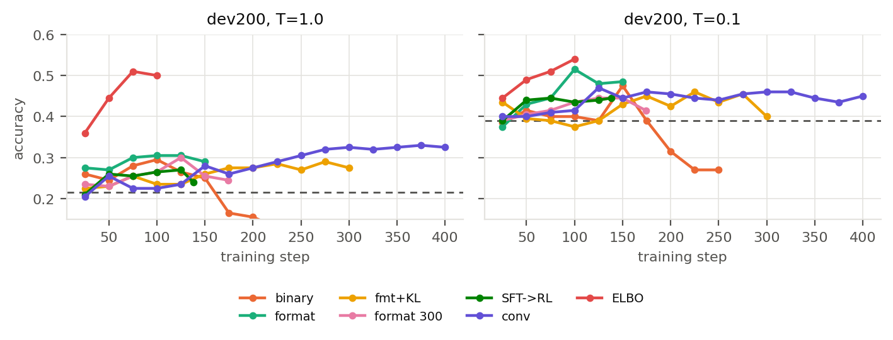
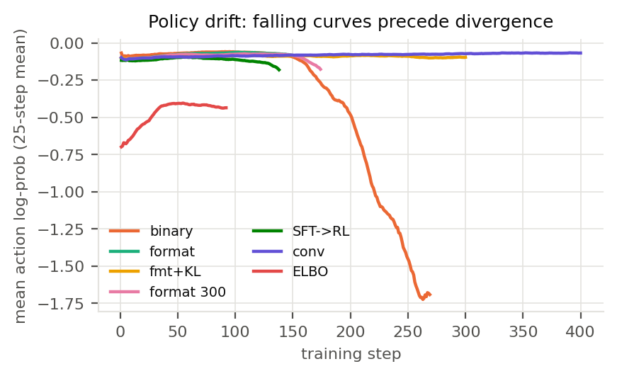
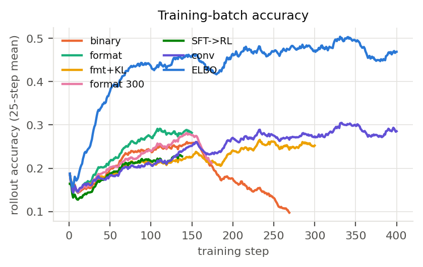
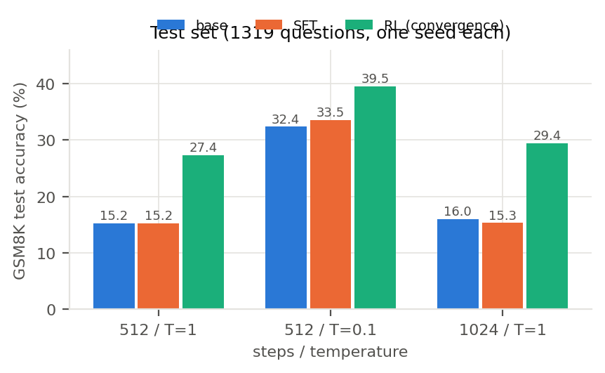
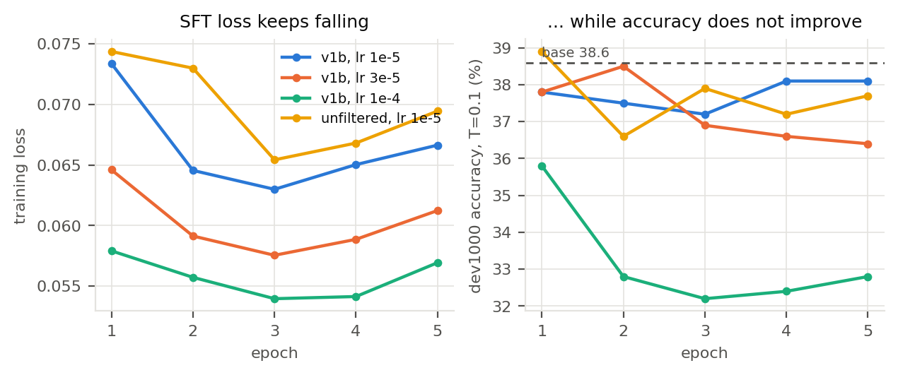
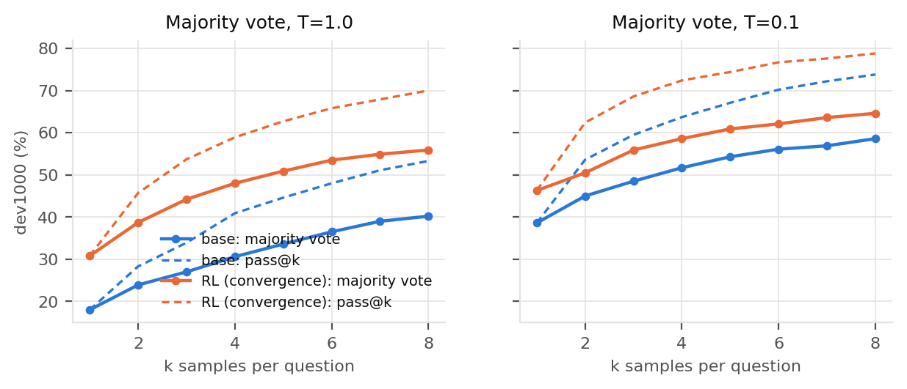
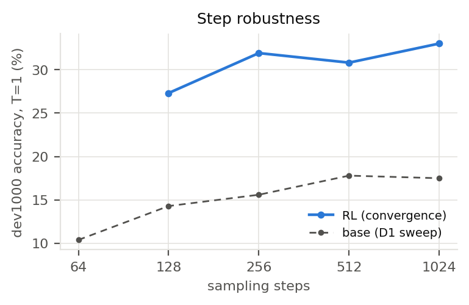
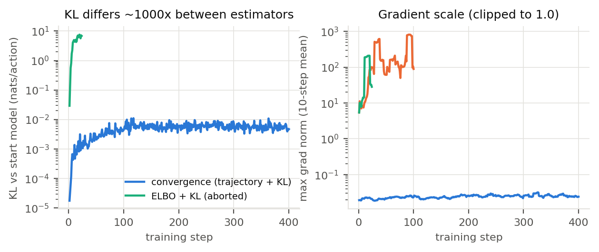

# 报告草稿（方向一：SFT + RL）

> 写于 2026-11-02（R45），11-03（R48）更新为最终结果：所有 GPU 实验已完成，定稿模型 = ELBO 收敛轮第 400 步（D37）。数字出处写在括号里。
> 结构按题目「预期成果」的六项来排，顺序做了调整：先给结论，再讲原理，最后是过程与反思（面试时也照这个顺序讲）。
> 交叉引用：决策依据 [02](../02-决策记录.md)、原理 [00](00-任务分析.md)/[03](03-RL算法与模型.md)、全过程复查 [09](09-阶段复查.md)、通俗版 [10](10-通俗讲解.md)。

---

## 摘要

在 TinyGSM 上预训练的 170M MDLM 上做了 SFT 与 GRPO RL，在 GSM8K 上用统一协议评测。

| GSM8K test（1319 题） | 512 步 T=1 | 512 步 T=0.1 | 1024 步 T=1（论文设置） |
|---|---|---|---|
| 原始 checkpoint | 15.2 | 32.4 | 16.0（论文 18.0） |
| SFT | 15.2 | 33.5 | 15.3 |
| RL（定稿：GRPO + ELBO log-prob） | **42.8** | **45.4** | **43.1** |

- **SFT 没有提升**：6232 条逐条核验的数据，test 上与原始模型持平（15.2 vs 15.2）。诊断表明它学到的是写法，不是解题。
- **RL 显著提升**：test 上 T=1 +27.6pp、T=0.1 +13.0pp（配对 p < 1e-19），超过免费的降温技巧（32.4）。
- **最重要的意外发现**：用于 RL 梯度的 log-prob，我们原本以"精确的轨迹概率"为主线、d1 式 ELBO 近似为对照；实测 ELBO 反而好得多（同配置 test 42.8 vs 27.4），训练也快 4–5 倍。原预期被推翻，如实记录。
- **RL 会发散**：轨迹法下二值奖励约第 160 步崩，格式奖励只推迟到第 174 步；KL + 学习率衰减可以稳定训练到 400 步。ELBO 不加 KL、只加衰减也能稳定到 400 步。
- **"先 SFT 再 RL"不比"直接 RL"好**：同配置 dev T=1 25.9 vs 31.6，p=0.0005。
- 其他：采样器 2 倍加速与三层等价验证；多数投票在同等采样次数下 RL 仍领先；步数鲁棒性；为什么到不了 90%。

---

## 1. 结论先行

| 问题 | 回答 | 证据 |
|---|---|---|
| 复现得准不准？ | 16.0%（论文 18.0），偏低但在噪声边缘；原版采样器 15.9%，两者一致 | test 1024 步 T=1 |
| SFT 有用吗？ | **没有**，test 上与原始模型对的题数完全相同（+47 / −47） | 配对 McNemar p=1.00 |
| RL 有用吗？ | **有**，test 512/T=1 15.2 → 42.8 | 配对 +406 / −42，p=7e-76 |
| 提升能归因于解码技巧吗？ | **不能**：降温到 T=0.1 的原始模型 32.4，RL 后 45.4；多数投票在同等采样次数下 RL 仍领先 | §4.4 |
| 精确轨迹 vs ELBO 近似？ | **ELBO 更好**（与预期相反），机制只有推测 | §4.2、§5.3 |
| 到 90% 吗？ | **到不了**：同等数据的 AR 也只有 54–63%；pass@8 是 70–79% | 08 Q37 |

---

## 2. 背景与原理要点

### 2.1 为什么选 MDLM（170M）

同仓库六个模型里按三个条件筛：① 起点准确率够高（GRPO 每组要"有对有错"）；② 采样策略的 log π 能精确算；③ 有可借鉴的 RL 文献。FLM/CANDI（0.2–0.3%）和 S-FLM（确定性 ODE，没有随机动作）被 ① 和 ② 淘汰；MDLM 与 Duo 打平，MDLM 胜在条件 ②③ 和对采样器优化的适用性。（02 D02）

### 2.2 采样器加速（不是终点，是前提）

原版每步对所有位置做 float64 采样再丢弃，在 80GB 卡上峰值 47GB、dev1000 一次评测约 20 分钟。新增 `FastAncestralSampler`：先在 float64 下抽"揭开硬币"，只对选中位置取 logits 并采样；另加 `skip_unchanged` 缓存。

- 等价性三层验证：① 16 组 token 逐位相同；② dev1000 15.0% vs 15.6%（p=0.72）；③ 153s → 76s，显存 47GB → 5GB。
- 副作用如实说明：`skip_unchanged` 与默认路径**同分布但不逐位相同**（TF32 下 cuBLAS 按子 batch 大小换 kernel），逐题对错差 1–4 题，所以所有配对比较都另跑同协议的 base。

### 2.3 RL 的核心技术点：轨迹概率

π(y|x) 要对所有揭开顺序求和，算不出；但策略梯度只需要 π(τ)——**这一条轨迹**的概率，而它在 MDLM 上可以精确分解为"每轮新揭开位置的 log p"。我们的实现（`rl/logprob.py`）：

- 由 (最终 token, 揭开轮次) 还原每一轮的画布——这依赖 MDLM"揭开后不再改写"；
- 每条轨迹分层抽 8 轮，权重 = 层大小，无偏；
- 精度：训练用 fp32 log-softmax，采样器（同上游）在 bf16 下做；更新前比率严格为 1（实测误差 0），训练-推理差最大 0.061（一个 bf16 ulp）。

对照臂 `--logprob elbo`（d1 式）：每条轨迹只做一次前向——整段答案全部遮住、只给题目——把各位置的 log p 加起来当作 log π 的近似。它不对应实际采样用的逐步策略，所以原本只作对照；结果见 §4.2。

---

## 3. 实验设置

| 项 | 设置 |
|---|---|
| 数据划分 | train 6473 / dev 1000 / test 1319；dev 内前 200 题用于选 checkpoint，后 800 题无偏报告 |
| 污染检查 | 13-gram 检查：test 2.2%、dev 近重复 13%；base 在近重复题上高 3.5pp，不显著 |
| 评测协议 | 512 步 + `skip_unchanged`，T ∈ {1, 0.1}，seed 1，batch 200；定稿另跑 1024 步对齐论文 |
| 统计 | 逐题配对 McNemar 精确双侧检验；bootstrap 95% CI |
| RL 配置 | GRPO + DAPO 技巧（clip-higher、动态采样、token 级归一化）；32 题 × G=8；rollout 128 步、T=1；lr 3e-5，每批 4 次更新 |

---

## 4. 结果

### 4.1 dev 上的学习曲线

> **图 1**：各 RL 配置在**留出的 dev200** 上的准确率，每 25 步一个点；虚线是 base 的同协议参照（左 T=1、右 T=0.1）。两条纵向读法：
> ① 轨迹法各臂：第 150 步之后，二值奖励（橙）一路跌到 base 以下，格式奖励（青）与 KL 轮（黄）持平或略跌，收敛轮（紫）持续缓慢上升；
> ② ELBO（蓝，无 KL，定稿）前 75 步就超过所有轨迹法配置，之后在两温度平均 49–52 的平台上；T=0.1 在第 125 步后从 54.5 缓降到 47–50。
> 单点噪声约 ±3pp，所以横轴上的折返不要逐点解读。

> **图 2**：被揭开 token 的平均 log-prob（25 步滑动平均），用来判断训练是否在崩。二值奖励（橙）从 −0.06 一路掉到 −1.7，是熵爆炸式的发散；SFT → RL（深绿）与格式奖励 300 步（粉）在 −0.08 → −0.18 一带掉下去，随后被刹车停住；收敛轮（紫）和 KL 轮（黄）稳定在 −0.08 附近。
> **ELBO（蓝）的绝对值不能与轨迹法比较**——它是在全遮盖画布上算的概率，本身就低（−0.4 ~ −0.7），只应看它的形状是否平稳。

> **图 3**：训练 rollout 正确率（25 步滑动平均），每点来自 32 道题。它受"每批题难不难"影响很大，只用来和别的运行做同题比较（所有运行同 seed、同题序）。

### 4.1b 主表（dev1000，512 步 + skip）

| 模型 | T=1 | 后 800 | T=0.1 | 后 800 |
|---|---|---|---|---|
| 原始 base | 18.0 | 17.1 | 38.6 | 38.5 |
| SFT（lr 1e-5，epoch 1） | 16.2 | 15.8 | 37.8 | 37.8 |
| RL 轨迹法（收敛轮第 400 步，原定稿 D36） | 30.8 | 30.4 | 46.3 | 46.6 |
| **RL ELBO（收敛轮第 400 步，定稿 D37）** | **50.0** | **49.4** | **50.5** | **50.6** |

### 4.2 RL 配方对比（dev1000，各自按事先定的规则选点）

| 配方 | log-prob | 选中步 | T=1 | T=0.1 | 平均 | 是否经过挑选 |
|---|---|---|---|---|---|---|
| **ELBO 收敛轮（无 KL，cosine）——定稿** | ELBO | 400 | **50.0** | **50.5** | **50.25** | 否（最后一步） |
| ELBO 对照臂（格式分，150 步） | ELBO | 150 | 48.1 | 51.3 | 49.70 | 否（smooth3 选中最后一步） |
| 格式分 100 步 | 轨迹 | 100 | 31.6 | 46.4 | 39.00 | 是（单点最高） |
| 收敛轮 400 步（KL + cosine，原定稿） | 轨迹 | 400 | 30.8 | 46.3 | 38.55 | 否 |
| 格式分（300 步跑满） | 轨迹 | 125 | 30.6 | 46.4 | 38.50 | 是 |
| 格式分 + KL | 轨迹 | 225 | 29.7 | 46.8 | 38.25 | 是 |
| 二值奖励 | 轨迹 | 150 | 28.5 | 46.2 | 37.35 | 是 |
| SFT → RL | 轨迹 | 125 | 25.9 | 46.8 | 36.35 | 是 |

两点结论：
1. **轨迹法内部**，除 SFT → RL 外的各配方两两配对都不显著（p = 0.14–1.00）：奖励怎么设计、加不加 KL，影响远小于"做不做 RL"。
2. **log-prob 的算法是唯一拉开差距的变量**：同为格式奖励、150 步、其余全同，ELBO 臂比轨迹法高 16.5pp（T=1）/ 4.9pp（T=0.1）；两个 ELBO 运行之间差 0.55pp（不显著）。ELBO 的优势主要在高温。

### 4.3 test 主表

> **图 4**：GSM8K test（1319 题，每题一个 seed）。三组柱子依次是 512 步 / T=1、512 步 / T=0.1、1024 步 / T=1（论文设置）。两个 RL 模型都明显高于 base 与 SFT；ELBO 定稿在三个设置下都最高；SFT 与 base 几乎重合。

| 模型 | 512/T=1 | 512/T=0.1 | 1024/T=1（对齐论文） |
|---|---|---|---|
| base | 15.2 | 32.4 | 16.0（论文 18.0；D1 原版采样器 15.9） |
| SFT | 15.2 | 33.5 | 15.3 |
| RL 轨迹法（收敛轮第 400 步，原定稿 D36） | 27.4 | 39.5 | 29.4 |
| **RL ELBO（收敛轮第 400 步，定稿 D37）** | **42.8** | **45.4** | **43.1** |

配对检验（512 步）：
- 定稿 vs base：T=1 +406 / −42（p = 7e-76），T=0.1 +267 / −95（p = 5e-20）；
- 定稿 vs 原定稿：T=1 +295 / −91（p = 3e-26），T=0.1 +190 / −112（p = 8e-6）；
- 原定稿 vs base（T=1）+219 / −59（p = 8e-23）；SFT vs base +47 / −47（p = 1.00，对的题数完全相同，只是换了一批）。

test 比 dev 难：base 与各 RL 模型都低约 3–7pp，所以 dev 上的相对比较仍然成立。

**如实说明 test 的使用**：定稿先定为轨迹法收敛轮（D36）并跑了 test；之后 ELBO 对照臂在 dev 上明显更好，按事先写好的规则（D37：候选中 dev1000 两温度平均最高）改为 ELBO，再跑一次 test。两次选择都只看 dev，test 没有参与选择；但 test 一共被两个 RL 模型用过，两行都保留。

### 4.4 消融

> **图 5**：SFT 的四组配置（左：训练 loss；右：T=0.1 的 dev 准确率）。loss 在每个学习率下都单调下降，准确率没有跟着上来；lr=1e-4（绿）loss 降得最多、准确率掉得最狠（第 2 个 epoch 起显著差于 base）。这是"SFT 学的是写法，不是做题"最直接的一张图。

> **图 6**：同题采 k 次、取多数答案（实线）与 pass@k（虚线），base 与收敛轮 RL 并排。左 T=1、右 T=0.1。
> ① 同样采样预算下 RL 始终领先（k=8：T=1 55.9 vs 40.2，T=0.1 64.6 vs 58.6），"涨分只是投票"的说法不成立；
> ② RL 单次（30.8）≈ base 投票 4 次（30.6）；
> ③ 虚线（pass@k）明显高于实线（投票），说明能力在、但多数题只能靠"多试几次"取出来。

> **图 7**：轨迹法 RL（原定稿，收敛轮第 400 步）在 dev 上随采样步数的准确率（T=1；ELBO 定稿未重做，成本原因），与 base 的 D1 扫描并列。RL 后 128 步就有 27.3%，256 步 31.9% 已接近 1024 步的 33.0%；base 从 64 步的 10.4% 到 1024 步的 17.5%。

> **图 8**：左：与起点模型的 KL（纳特 / 动作，对数轴）。轨迹法收敛轮稳定在 10⁻³ 量级；ELBO 带 KL 的那次第 20 步就到 6–7，β=0.04 下罚项约为策略梯度的 10 倍，所以那次尝试被停掉（02「已更正的判断」）。右：每步最大梯度范数（10 步均值，对数轴）：ELBO 比轨迹法大 3–4 个数量级，所有运行都被裁剪到 1.0；ELBO 收敛轮 1600 次更新里有 140 次（8.8%）因超过最近 50 次中位数的 10 倍被跳过。

| 消融 | 结果 |
|---|---|
| SFT 数据过滤 vs 不过滤（D10） | 10 组配对全不显著（≤1.1pp），能检出 2–3pp 以上 |
| SFT 学习率 1e-5 / 3e-5 / 1e-4 | loss 越低准确率越差；1e-4 从第 2 个 epoch 起显著更差 |
| 格式奖励（能跑但错给 0.1） | 有信号样本 47% → 93%，运行时错误显著下降；但**在 dev 上与二值不可分辨**，且只推迟发散 14 步 |
| KL β=0.04 | 让训练跑到 300/400 步不崩；代价是学习略慢（与跑间随机性同量级） |
| 每批 4 次更新 | 同一批 rollout 上用 PPO clip，clip 比例 0.5–1.5%，始终未饱和 |
| PAD 是否计入动作（D20） | PAD 占动作 68%、只占梯度范数 11%（梯度诊断）；没有做两臂训练对比（成本原因） |
| 步数鲁棒性（RL 后，dev，T=1） | 128 / 256 / 512 / 1024 步 = 27.3 / 31.9 / 30.8 / 33.0；base（D1）10.4·14.3 / 15.6 / 17.8 / 17.5（64/128 步起）。RL 后 256 步已接近平台 |
| 多数投票 / pass@k（dev，8 个不同 seed；RL 指轨迹法原定稿） | 同样采 8 次时 RL 仍领先：T=1 k=8 base 40.2 vs RL 55.9（k=1 18.0 vs 30.8），pass@8 53.3 vs 70.0；T=0.1 k=8 58.6 vs 64.6，pass@8 73.8 vs 78.8。**RL 单次（30.8）≈ base 投 4 次（30.6）**。ELBO 定稿单次 T=1 就有 50.0，已高于 base 投 8 次（40.2）；它自己的投票没有做 |
| 精确轨迹 vs ELBO 近似（D12） | **ELBO 更好**：同配置 150 步 dev1000 48.1 / 51.3 vs 31.6 / 46.4；收敛配方 400 步 50.0 / 50.5 vs 30.8 / 46.3；test 42.8 / 45.4 vs 27.4 / 39.5。训练部分每步 8.3 s vs 约 40 s。ELBO 下 KL 量级大约 1000 倍，沿用 β=0.04 会压住训练（§5.2） |

### 4.5 错误分析（dev1000，第 150 步二值臂 vs base）

| | 对 | 能跑但错 | 运行时错 | 语法错 |
|---|---|---|---|---|
| base T=0.1 | 386 | 474 | 138 | 2 |
| RL T=0.1 | 462 | — | 46 | 2 |
| base T=1 | 180 | 429 | 383 | 7 |
| RL T=1 | 285 | — | 137 | — |

**RL 的主要收益来自"代码能跑起来"**（运行时错误大幅下降），推理错误减少得少。这和"降温主要修好的是跑不起来"是同一个现象。

---

## 5. 过程分析与反思（这一节是重点）

### 5.1 无效的尝试

| 尝试 | 结果 | 原因 |
|---|---|---|
| SFT（6232 条高质量数据，3 个 lr × 5 epoch） | 不涨分，高温更差 | 模仿学的是写法；分布压窄后高温更容易偏 |
| 数据过滤消融 | 无差别 | SFT 本来就没学到推理，3.6% 的错误样本无从体现 |
| 格式奖励 | dev 上无差别，只推迟发散 | 信号变密了，但方向不变 |
| 前两轮 RL 超参（lr 1e-6–1e-5，单次更新） | 15 小时量级白跑 | 权重只动 0.045%，"学习率太小" |
| 第一次 KL 轮（不截断 k3） | 第 14 步梯度范数约 2500 | exp(d) 无界，等于一次异常更新 |
| ELBO 收敛轮第一次尝试（照搬 β=0.04） | 第 24 步停掉 | ELBO 下 KL 6–7 nats/动作（轨迹法约 0.006），β·KL 约为策略梯度的 10 倍 |

### 5.2 踩过的坑（工程）

| 坑 | 症状 | 定位方式 | 修复 |
|---|---|---|---|
| SFT 分隔符 | val loss 20 步降 3 倍 | 拆 loss + 单 token 遮盖测试 | 用字面量 `\n`，加断言 |
| `skip_unchanged` 不逐位相同 | 逐字测试"失败" | 扫子 batch 大小发现 kernel 切换 | 同分布即可，配对比较用同协议 base |
| KL 日志 | 值小约 30 倍 | 代码审查 + 冒烟对比 | 每个 chunk 已全局归一化，不再加权平均 |
| 刹车变量名冲突 | 首次启动第 1 步崩 | 日志回溯 | 改名；**改训练循环必须用正式参数冒烟** |
| 选点规则挑到噪声尖峰 | dev200 单点最高 ≠ 最好 | 看两侧邻点 + 训练正确率 | 三点平滑 / 收敛轮取最后一步 |
| 换 log-prob 时照搬 KL 系数 | ELBO 收敛轮训练正确率逐步落后（−6pp） | 算 β·KL 与策略梯度 loss 的比例 | 去掉 KL；换估计量前先估 KL 量级 |

### 5.3 被实验推翻的预期：精确轨迹 vs ELBO

我们原本的判断（D12）：轨迹法是"精确且与采样策略一致"的 log π，ELBO 是"有偏、和逐步采样不一致"的近似，所以轨迹法做主线、ELBO 只作对照，并预测 ELBO"更便宜但更差"。实验结果相反：ELBO 在 dev 和 test 上都明显更好，训练也快 4–5 倍。

可能的原因（**推测，没有做专门实验核实**）：
1. **信号强度**：轨迹法里，大多数动作是在画布几乎写满时揭开的，此时模型几乎确定（PAD 占 68%，平均 log p ≈ −0.002），这些动作的梯度接近 0；有效信号只来自少数早期、不确定的位置。ELBO 在全遮盖画布上算每个位置的概率，所有位置都处在"最不确定"的状态，梯度大得多（常态梯度范数 20–150，轨迹法约 0.02）。
2. **训练的正好是第一步的决策**：生成从全遮盖画布开始，ELBO 优化的就是这一步的预测；而早期写下的 token 决定了后面整条轨迹的走向。
3. **"无偏"不等于"好用"**：轨迹法的梯度估计无偏，但在这个设置下方差 / 信噪比可能更差。

代价也要说清楚：ELBO 梯度波动极大（最大 1.5e8，全靠裁剪），8.8% 的更新被尖峰规则跳过；KL 的量级完全不同；第 125 步之后低温表现缓慢退化（T=0.1 从 54.5 降到 47–50），而高温稳定。只有两个 ELBO 运行（两个都是同一 seed 的题序），没有多 seed。

### 5.4 方法论上的两个判断（如实记录）

1. **"只有一个 seed"的影响被实测了**：两次同配置、同 seed 的运行，dev200 每点差 1–5pp，但选中 checkpoint 的 dev1000 差别 p = 0.56 / 1.00。所以跑间差异主要在"选哪一步"，不在"最终水平"。
2. **dev 后 800 题的"无偏"只在单臂内成立**：跨轮次挑定稿时会用到 dev1000 全部，这时只有 test 是干净的。

### 5.5 下一步

- 弄清 ELBO 为什么更好：拆分梯度信号（按揭开轮次 / 位置统计梯度贡献）、混合两种估计量、多 seed 复现；
- 数据侧：用 TinyGSM 原数据混入 SFT 防遗忘、RFT 多轮迭代；
- 规模侧：换更强的预训练模型、或用 Duo 验证"可改写 token"是否让 RL 更有效；
- 解码侧：block / 半自回归解码、按置信度并行解码（D16 已说明为什么没做）。

---

## 6. 交付物清单

| 文件 | 内容 |
|---|---|
| `code/` | 上游 s-flm 原样 + 我们的新增（`fast_sampler.py`、`rl/`、`scripts/`、`tests/`） |
| `runs/` | 每次运行的配置、指标、汇总表 |
| `docs/02` | 全部决策与理由、已更正的判断 |
| `docs/08` | 问答记录（面试复盘用） |
| `docs/09` | 阶段复查：哪些结论站得住、哪些错了 |
| `docs/10` | 通俗讲解 |
| `docs/11` | 本报告 |
